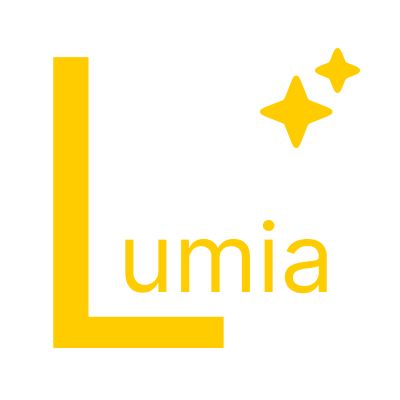

<div align="center">



# Crystal Launcher

**A cross-platform Minecraft launcher** · Tauri 2 + Rust + Vue 3

[](#installation)
[](#installation)
[](https://tauri.app/)
[](https://vuejs.org/)
[](https://www.rust-lang.org/)
[](LICENSE)

[Website](https://crystallauncher.cn) · [Download](https://crystallauncher.cn) · [Lumi language reference](docs/lumi-reference.md) · [Plugin system design](docs/插件系统设计.md)

**English** · [简体中文](README.zh-CN.md)

</div>

---

## Overview

Crystal Launcher is a lightweight, cross-platform Minecraft launcher built with **Rust + Tauri 2**, with a **Vue 3 + TypeScript** interface.

It ships as a small installer, starts quickly, and includes full version management and content-download capabilities. It also comes with **Lumi**, a purpose-built plugin language that lets people with no programming background extend the launcher.

<!--
  Screenshot placeholder: add real screenshots under .github/screenshots/ or docs/images/ and uncomment.
  <p align="center"></p>
-->

## Features

### 🎮 Game and versions
- **Multi-version management** — install, update, and remove vanilla and **Forge / NeoForge / Fabric / Quilt** instances
- **One-click launch** with automatic Java version matching
- **Microsoft account sign-in** (full MS → XBL → XSTS → Minecraft token chain)
- **Multiplayer support** (powered by Terracotta)
- **Crash report viewer** that points directly to the relevant log when startup fails
- **Touch Bar** support on macOS

### 📦 Content downloads
- One-stop download and installation for versions, mods, modpacks, resource packs, and shaders, plus export of installed instances as `.mrpack` modpacks
- **BMCLAPI** mirror support for users in China, with no proxy required
- Support for both the **Modrinth** and **CurseForge** ecosystems

### 🎵 Experience
- Built-in **music player** with a persistent playback bar
- Built-in **AI assistant** panel
- **Dark theme** with a clean, flat interface
- **9 interface languages**: Simplified Chinese, Traditional Chinese (Taiwan), Traditional Chinese (Hong Kong), **Literary Chinese — 文言（華夏）**, English, **Upside-down English — 颠倒英文** (just for fun), Japanese, Korean, and French

### 🧩 Plugin system (Lumi)
- A purpose-built **Lumi plugin language**: Python-like indentation, minimal English keywords, and **readable without any programming background**
- A `.cplugin` package is a zip file with a different extension and may contain scripts and assets
- Event-driven model (`listen widget.event`); the UI is driven by a widget tree interpreted from the script
- Supports installation from a zip archive, a folder, or a single file
- See the [Lumi language reference](docs/lumi-reference.md) and [plugin system design](docs/插件系统设计.md) (currently in Chinese)

### 🔧 Other
- Automatic Java path detection and manual selection, plus memory allocation settings
- In-app update checks and changelogs

## Installation

Visit **[crystallauncher.cn](https://crystallauncher.cn)**. The site detects your platform and offers the matching installer. All platform builds are also published on [GitHub Releases](https://github.com/xtg44/Crystal-Launcher/releases):

| Platform | Package |
|---|---|
| Windows 10+ | `.exe` |
| macOS 10.15+ | `.dmg` (Apple Silicon / Intel) |
| Linux x64 | `.deb` (Debian / Ubuntu, available on GitHub Releases) |

> **v1.0 stable** was released on 2026-10-24. Feedback is welcome.

> **Note**: game files are downloaded on demand by the launcher from Mojang's official sources (and the BMCLAPI mirror) when you install a version.
> The installer itself does not contain or distribute any game files.

## Tech stack

| Layer | Technology |
|---|---|
| Desktop framework | Tauri 2 |
| Backend | Rust (about 12,000 lines across 6 modules) |
| Frontend | Vue 3.5 (Composition API + `<script setup>`) + TypeScript 5.6 |
| Build | Vite 6 |
| Internationalization | vue-i18n 11 |
| Icons / rendering | @iconify/vue, markdown-it, qrcode-generator |

Rust backend modules:

| Module | Responsibility |
|---|---|
| `main.rs` | Core commands, version parsing, download and launch logic |
| `lumi.rs` | Lumi plugin language interpreter |
| `plugins.rs` | Plugin loading, registration, and lifecycle |
| `music.rs` | Music playback |
| `auth.rs` | Microsoft sign-in and token refresh |
| `touchbar.rs` | macOS Touch Bar integration |

## Project structure

```
Crystal Launcher/
├── src/                  # Vue 3 frontend
│   ├── components/       # 24 views and components
│   ├── i18n/             # 7 languages
│   ├── utils/            # tauri.ts invoke wrapper, svg.ts, etc.
│   └── App.vue
├── src-tauri/            # Rust backend
│   ├── src/              # 6 modules
│   ├── capabilities/     # Tauri permission declarations
│   ├── icons/            # Platform icons
│   └── tauri.conf.json
├── docs/                 # Plugin language reference, plugin system design, development guide
├── public/               # Static assets (icons, skins, etc.)
└── package.json
```

## Local development

### Requirements

- [Node.js](https://nodejs.org/) 18+
- [Rust](https://rustup.rs/) stable
- Tauri system dependencies for your platform (see [Tauri prerequisites](https://tauri.app/start/prerequisites/))

### Getting started

```bash
git clone https://github.com/xtg44/Crystal-Launcher.git
cd Crystal-Launcher
npm install
npm run tauri dev        # Opens the development window with frontend hot reload
```

### Building installers

```bash
npm run tauri build                                    # Current platform

# macOS: choose a target architecture
rustup target add x86_64-apple-darwin                  # Intel
npm run tauri build -- --target x86_64-apple-darwin
npm run tauri build -- --target universal-apple-darwin # Universal binary
```

Build output:

| Platform | Path |
|---|---|
| macOS | `src-tauri/target/<triple>/release/bundle/dmg/*.dmg` |
| Windows | `src-tauri/target/release/bundle/nsis/*.exe` |
| Linux | `src-tauri/target/release/bundle/{deb,appimage}/*` |

> For cross-compiling on Windows, you can use [`cargo-xwin`](https://github.com/rust-cross/cargo-xwin): `tauri build --runner cargo-xwin --target x86_64-pc-windows-msvc`.

## Contributing

Issues and pull requests are welcome.

- For bug reports, include your **OS version, launcher version, and reproduction steps**. If the launcher fails to start, attach the crash report or logs.
- Before submitting code, make sure `npm run build` passes, including the `vue-tsc` type check.
- When adding UI text, update the language files under `src/i18n/` as well.

See the [frontend development guide](docs/前端开发指南.md) (currently in Chinese) for frontend conventions and backend command interfaces.

## License

This project is released under the **MIT License**. See [LICENSE](LICENSE) for the full terms.

Copyright (c) 2026 Crystal

You are free to use, modify, and distribute this project, including for commercial purposes, as long as you retain the copyright and license notices.

---

<div align="center">

[Minecraft](https://www.minecraft.net/) is a trademark of Mojang Studios. This project is not affiliated with Mojang Studios or Microsoft.

</div>